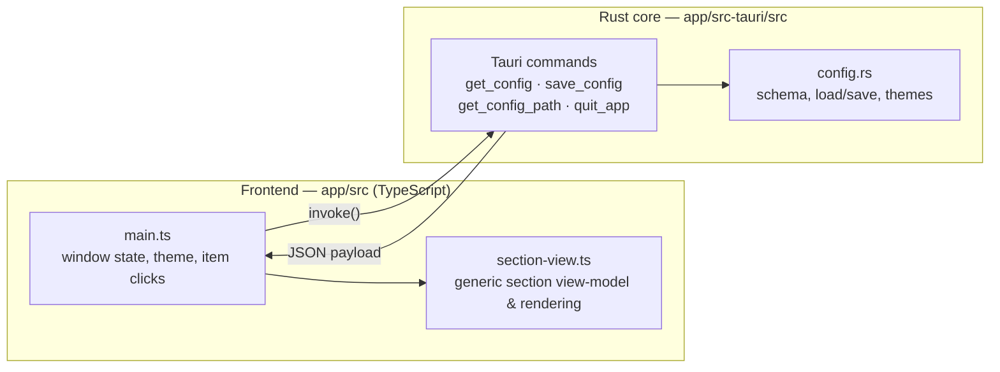

# Architecture

## What this is

Orbitbar is a Tauri 2 desktop bar boilerplate app: a Rust core plus a TypeScript/HTML
frontend, packaged as a native desktop binary per OS (Windows, macOS, Linux). It provides a clean, modular desktop widget framework with customizable side panels and context menus.

## How it fits together

The frontend talks to the Rust core through Tauri's `invoke()` IPC.

## Layers

| Layer | Component | Responsibility |
| --- | --- | --- |
| Window/UI | `app/src/main.ts`, `app/src/styles.css`, `app/index.html` | Crescent bar geometry, collapse/expand, drag, theme application, item clicks, panel and context-menu toggling |
| View-model | `app/src/section-view.ts` | Generic section view-models (`section:<id>`) and DOM rendering for side panel custom views |
| Tauri commands | `app/src-tauri/src/lib.rs` | `get_config`, `save_config`, `get_config_path`, `run_command`, `run_panel_command`, `quit_app`, `place_window`, `plan_window`; window placement and autostart reconciliation on launch |
| Panel commands | `app/src-tauri/src/panel.rs`, `app/src-tauri/src/launch.rs` | `panel:<program> [args]` items: `launch.rs` parses and resolves the command; `panel.rs` runs it and returns output to display |
| Placement | `app/src-tauri/src/placement.rs` | Pure window-placement rules: grow toward the side with room, clamp into work area, collapse anchoring |
| Config | `app/src-tauri/src/config.rs` | Schema (`AppConfig`), per-OS config dir resolution, load/save, `dark` and `light` theme palettes |

## Interaction model

- **Side Panel.** Clicking a section cell opens the side panel beside the bar. Clicking the same cell again, pressing Escape or using the close button closes it.
- **Context menu.** A right click on the bar (or left click on the settings cell) opens a menu card inside the webview.
- **Placement.** The bar can sit anywhere on screen. Dropping the bar clamps it into its monitor, and `position` and `monitor` are saved to `config.json`.
- **One instance.** `tauri-plugin-single-instance` brings the running bar forward if launched again.
- **Themes.** `dark` (default) and `light` are palettes in `config.rs`; the frontend maps them to `--ob-*` CSS custom properties.
