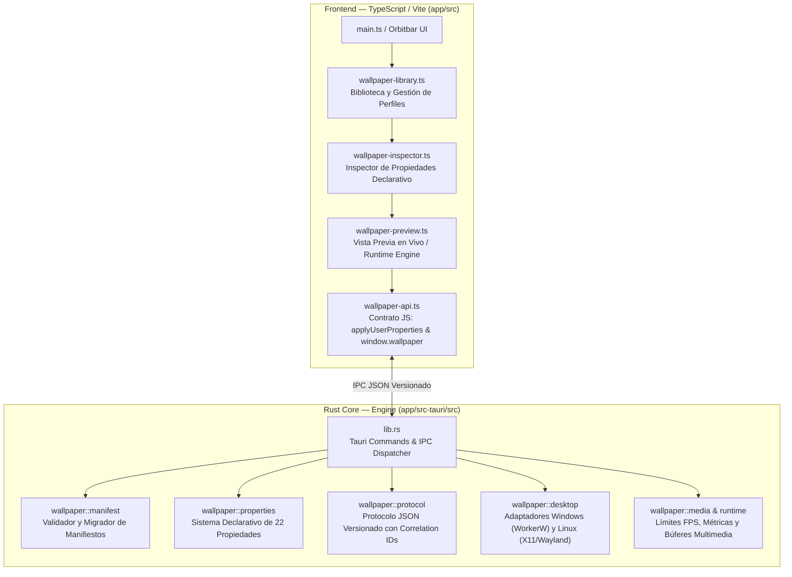

# Arquitectura del Motor (Wallpaper Engine + Orbitbar)

## Visión General

Este proyecto combina la estructura ligera de barra flotante de **Orbitbar** con un **Motor de Wallpapers** funcional para Windows y Linux (con soporte macOS preservado).

Permite ejecutar fondos de pantalla animados (HTML/CSS/JS, vídeo en bucle e imágenes estáticas), interactuar con el escritorio del sistema operativo, gestionar propiedades declarativas en tiempo real y editar la configuración mediante un panel inspector integrado.

## Diagrama de Componentes



## Estructura de Módulos Rust

| Módulo | Archivo | Responsabilidad |
| --- | --- | --- |
| **Manifest** | `src/wallpaper/manifest.rs` | Carga de `project.json`/`wallpaper.json`, validación de campos obligatorios, esquemas versionados. |
| **Properties** | `src/wallpaper/properties.rs` | Definición de las 22 propiedades declarativas, reglas de validación, límites, visibilidad condicional (`visible_if`). |
| **Protocol** | `src/wallpaper/protocol.rs` | Definición del protocolo de mensajes JSON `{ version, id, type, name, payload }` para eventos, solicitudes, respuestas y errores. |
| **Store & Profile** | `src/wallpaper/profile.rs`, `store.rs` | Persistencia de configuraciones de wallpapers, perfiles asignados por monitor y migraciones. |
| **Desktop Adapter** | `src/wallpaper/desktop.rs` | Adaptadores OS: Windows (`SystemParametersInfoW`, `WorkerW` parenting, sesión), Linux (X11 root window / xwinwrap, Wayland layer-shell protocol detection & fallbacks). |
| **Media & Runtime** | `src/wallpaper/media.rs`, `runtime.rs` | Control multimedia, límites FPS configurables, pausa en segundo plano, aislamiento de rutas y presupuestos de recursos. |

## Sistema de Propiedades Declarativas (22 Tipos)

El motor soporta los siguientes tipos declarativos sin requerir programación manual del formulario:

1. `color`
2. `slider`
3. `checkbox`
4. `combo`
5. `textinput`
6. `textarea`
7. `number`
8. `file`
9. `directory`
10. `date`
11. `time`
12. `datetime`
13. `font`
14. `keybind`
15. `colorgradient`
16. `vector2`
17. `vector3`
18. `range`
19. `button`
20. `section`
21. `label`
22. `custom`

## API Pública JavaScript (`window.wallpaper` y `applyUserProperties`)

Compatibilidad garantizada con el estándar de Wallpaper Engine:

```javascript
window.wallpaperPropertyListener = {
  applyUserProperties(properties) {
    if (properties.customcolor) {
      document.documentElement.style.setProperty("--wallpaper-color", properties.customcolor.value);
    }
  }
};
```

Y la API moderna `window.wallpaper`:

```javascript
window.wallpaper.on("propertyChange", (data) => { ... });
window.wallpaper.setProperty("intensity", 0.8);
window.wallpaper.getSystemInfo().then(info => console.log(info));
```

## Protocolo Rust ↔ JavaScript

Mensajes estructurados JSON:
- `version`: "1.0"
- `id`: Identificador único de solicitud / correlación
- `type`: `event` | `request` | `response` | `error`
- `name`: Nombre de la acción o evento (ej. `apply_properties`, `get_runtime_info`)
- `payload`: Datos validados según el esquema en Rust.
